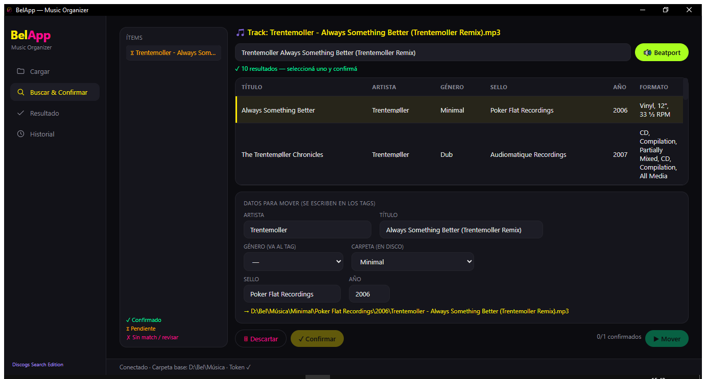
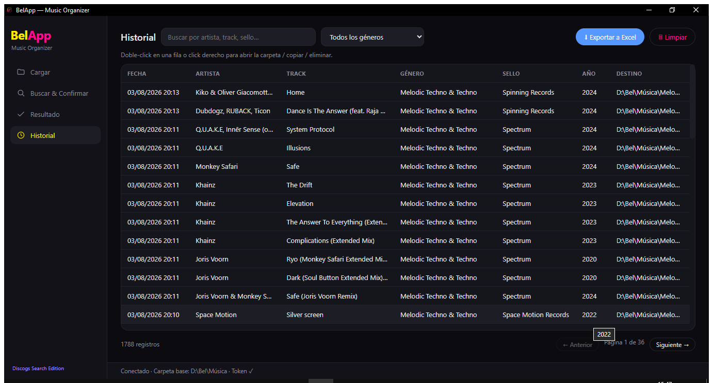

# 🎧 BelApp — Music Organizer

> Organizador de música para DJs que enriquece archivos con metadata de **Discogs**, valida los tags y ordena todo automáticamente en una estructura de carpetas por **género / sello / año** — y además genera playlists para **Traktor**.


> 🇬🇧 [English version](README.en.md)

---

## 📖 Sobre el proyecto

Como DJ, organizar cientos de tracks descargados es tedioso: hay que buscar el género, el sello y el año de cada uno, etiquetar los archivos y moverlos a la carpeta correcta. **BelApp** automatiza todo ese flujo en una sola aplicación de escritorio.

El flujo de trabajo es:

```
01 · Cargar  →  02 · Buscar & Confirmar  →  03 · Resultado  →  04 · Historial
```

1. **Cargar** tracks sueltos, carpetas de EP/Album o escanear una carpeta entera.
2. **Buscar en Discogs** la metadata de cada ítem y **validarla** comparando los datos del archivo con los del release antes de aceptar.
3. **Mover** los archivos confirmados a `Género / Sello / Año /`, escribiendo los tags ID3/FLAC en el camino.
4. **Consultar el historial** persistente de todo lo procesado, y **generar playlists** para Traktor.

---

## 📸 Capturas

**Buscar & Confirmar** — búsqueda en Discogs, validación de metadata y preview del destino:



**Historial** — registro persistente de todo lo procesado, con búsqueda, filtros y paginación:



---

## ✨ Funcionalidades

### Organización
- 📥 Tres modos de carga: tracks individuales, carpeta de EP/Album, o escaneo de una carpeta (salteando las carpetas de año ya ordenadas).
- 🏷️ Lectura y escritura de tags **ID3** (MP3/WAV/AIFF) y **Vorbis** (FLAC) con `mutagen`.
- 📂 Movimiento automático a una estructura `Género / Sello / Año / archivo`, con guardas (no pisa destinos, borra solo carpetas vacías — **nunca elimina audio**).
- 🎚️ **Normalizador de géneros con revisión manual**: mapea los estilos crudos a categorías propias de DJ, y te muestra una lista donde revisás/corregís cada track (checkbox + desplegable) o asignás en lote antes de aplicar.
- 🔤 **Detección de sellos parecidos**: al tipear el sello, avisa si ya existe una carpeta similar (typos, sufijos como *Music/Records*) para evitar duplicados.

### Integración con Discogs
- 🔍 Búsqueda contra la **API REST de Discogs** con autenticación por token.
- ⏱️ **Rate limiting** propio (pausa de 1.1s) para respetar el límite de la API.
- 🔁 **Reintento automático**: si la búsqueda completa no devuelve resultados, reintenta usando solo el nombre del artista.
- 🧵 Búsquedas en **segundo plano** para que la interfaz nunca se congele.
- 🆚 **Panel de comparación** lado a lado: datos del archivo vs. datos de Discogs, para validar antes de mover.

### Playlists para Traktor
- 🎧 Genera un archivo **`.m3u8` por Género + Año** leyendo los tags de la biblioteca (por referencia, sin mover ni copiar audio), listo para importar en Traktor.

### Seguridad y control
- ⚠️ **Detección de duplicados**: avisa (en la carga, en la validación y al mover) si un track ya figura en el historial.
- ⮌ **Deshacer último movimiento**: devuelve los archivos a su ubicación original y limpia los registros asociados.
- 🚦 **Límite por tanda** para evitar bloqueos de UI y mantener el flujo manejable.

### Persistencia e historial
- 💾 `config.json` recuerda el token y la carpeta base entre sesiones.
- 🗂️ **Historial persistente** (`historial.json`) con artista, track, género, sello, año, fecha y destino.
- 🔎 Pestaña de historial con **búsqueda en vivo**, filtro por género, **paginación**, **exportación a Excel**, menú contextual (click derecho) y "abrir en carpeta".

---

## 🛠️ Stack técnico

| Categoría | Tecnología |
|---|---|
| **Lenguaje** | Python 3 |
| **Interfaz** | **PyWebView** (ventana nativa) + **HTML / CSS / JavaScript** (UI web-style) |
| **Cliente HTTP / API** | `requests` (API REST de Discogs) |
| **Metadata de audio** | `mutagen` (ID3 y FLAC) |
| **Testing** | `pytest` — **122 tests** sobre la lógica pura |
| **Empaquetado** | `PyInstaller` (ejecutable `.exe` standalone) |
| **Sistema de archivos** | `pathlib`, `shutil` |
| **Persistencia / export** | `json`, `openpyxl` (Excel) |
| **Utilidades** | `re` (parsing), `webbrowser`, `datetime` |

---

## 🚀 Instalación y uso

### Requisitos
```bash
pip install requests mutagen pywebview openpyxl
```

### Ejecutar
```bash
python main.py
```
> La versión original en tkinter (`belapp.py`) se mantiene en el repo **solo como referencia** — la app actual es la de PyWebView.

### Tests
```bash
python -m pytest tests/ -q
```

### Ejecutable standalone (sin instalar nada)
Se empaqueta con PyInstaller en un único `.exe` que corre en cualquier Windows sin Python ni dependencias:
```bash
pyinstaller --noconfirm --onefile --windowed --name BelApp --add-data "web;web" main.py
```
El resultado queda en `dist/BelApp.exe`. La configuración (`config.json`) y el historial (`historial.json`) se guardan junto al ejecutable.

### Configuración inicial (una sola vez)
1. Click en **🔑 Obtener token** → se abre Discogs en el navegador.
2. Generá un token (*Settings → Developers → Generate new token*) y pegalo en el campo **Discogs token**.
3. Elegí tu **carpeta base** de música.

---

## 🏗️ Arquitectura

La app está separada en **3 capas** con responsabilidades claras — lo importante vive en `core/`, aislado de la UI y **testeado**:

- **`web/`** (`index.html` + `style.css` + `app.js`): la interfaz moderna (4 vistas). El estado de la UI vive en JS.
- **`api.py`**: la clase `Api` = puente PyWebView. El frontend la invoca como `pywebview.api.metodo()`. Pegamento fino.
- **`core/`**: **lógica pura y testeada** (sin UI): parsing de nombres, mapeo/normalización de géneros, lectura/escritura de tags, construcción de rutas, cliente de Discogs, historial, playlists, detección de sellos parecidos.

Decisiones de diseño destacadas:
- Toda la lógica importante es **pura y con tests** (`core/`), así se puede verificar sin levantar la interfaz.
- Las búsquedas en Discogs y los movimientos de archivos son **no bloqueantes**, para que la UI nunca se congele.
- La detección de duplicados usa **normalización de nombres** (minúsculas + solo alfanumérico) para tolerar diferencias de formato.
- El "deshacer" registra los pares `origen → destino` de cada movimiento para revertirlos de forma segura, sin pisar archivos existentes.
- **Nunca se borran archivos de audio**: solo se mueve y se eliminan carpetas vacías.

---

## 📁 Estructura del repo

```
Belapp/
├── main.py            # Punto de entrada (abre la ventana PyWebView)
├── api.py             # Puente PyWebView (clase Api) que invoca el frontend
├── core/              # Lógica pura y testeada (sin UI)
│   ├── parsing.py     #   nombres de archivo/carpeta → metadata
│   ├── genres.py      #   mapeo y normalización de géneros
│   ├── metadata.py    #   lectura/escritura de tags ID3/FLAC
│   ├── discogs.py     #   cliente de la API (rate-limit + fallback)
│   ├── organizer.py   #   construcción de rutas destino
│   ├── history.py     #   historial + detección de duplicados
│   ├── labels.py      #   detección de sellos parecidos
│   ├── playlists.py   #   armado de playlists .m3u8 para Traktor
│   └── ...
├── web/               # UI web-style (index.html, style.css, app.js)
├── tests/             # Suite de pytest (122 tests)
├── belapp.py          # Versión vieja en tkinter (solo referencia)
└── README.md
```

> `config.json` (token) e `historial.json` se crean al usar la app y **no se versionan**.

---

## 💡 Skills demostradas

Este proyecto pone en práctica:

- **Integración con APIs REST de terceros** (autenticación, rate limiting, manejo de errores y reintentos).
- **Arquitectura en capas** con lógica pura aislada de la UI, y **testing con pytest** (TDD).
- **Desarrollo de GUI de escritorio** moderna (PyWebView + HTML/CSS/JS) con manejo de estado y navegación entre vistas.
- **Procesamiento de archivos y metadata** binaria (tags de audio) con operaciones seguras (guardas, undo).
- **Persistencia de datos** en JSON y exportación a Excel.
- **Diseño de UX**: validación previa, prevención de errores (duplicados, sellos parecidos), recuperación (undo) y feedback claro.
- **Empaquetado y distribución** (PyInstaller → `.exe` standalone).

---

## 🔮 Mejoras futuras

- [ ] Carga de archivos en segundo plano con barra de progreso (para tandas grandes).
- [ ] Visualización de la carátula del release de Discogs en el panel de comparación.
- [ ] Estadísticas del historial (tracks por género / sello / año).
- [ ] Flujo OAuth para obtención automática del token.
- [ ] Tomar el año desde la carpeta cuando falta en el tag (para las playlists).

---

## 👤 Autora

**Belén Egaña** — DJ y desarrolladora.

Proyecto personal desarrollado para optimizar el flujo real de organización de una biblioteca musical de DJ.

---

*Desarrollado con Python 🐍 · Metadata por [Discogs](https://www.discogs.com/)*
